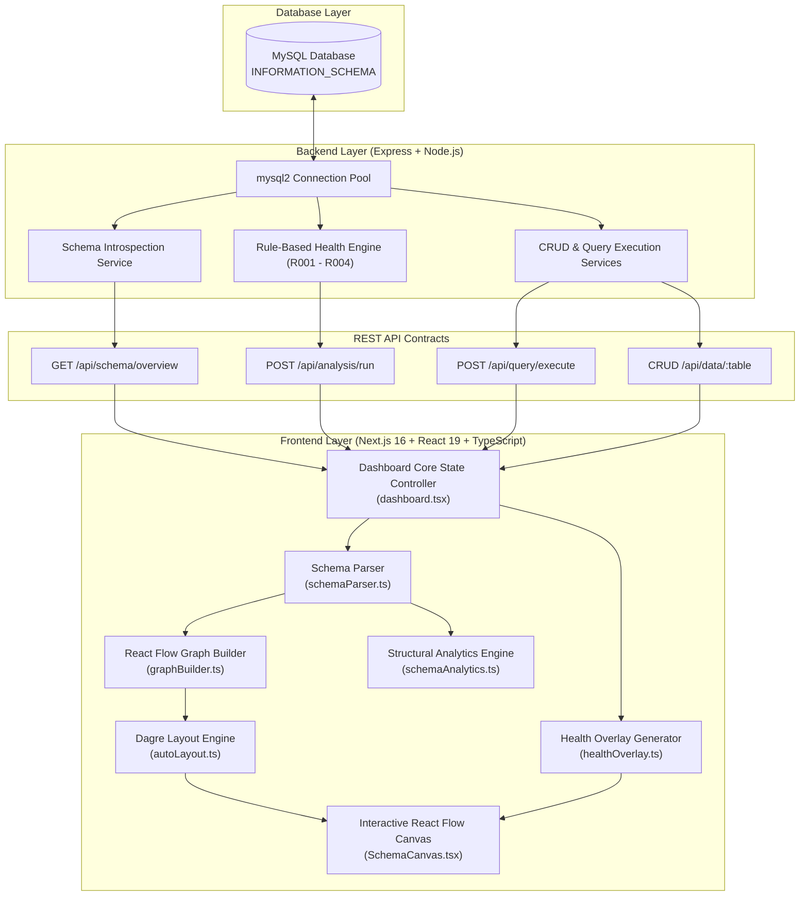

# Smart Database Visualizer — Milestone 5 Technical Documentation

## 1. Project Overview
Smart Database Visualizer is a full-stack, enterprise-grade schema visualization, structural analytics, and health inspection platform. It introspects real relational databases (such as MySQL) using `INFORMATION_SCHEMA`, converts raw catalog metadata into a normalized internal data representation, and presents an interactive, high-performance Entity-Relationship graph in the browser powered by React Flow and Dagre automatic hierarchical layout.

Milestone 5 represents the complete unification of:
- Modern React Flow custom table nodes and declared relationship edges.
- Size-aware Dagre layout engine with orientation toggle (LR / TB) and position caching.
- Deep Dashboard integration with seamless view switching (Schema, Health, Query, CRUD).
- Comprehensive 5-tab Table Explorer for in-depth inspection of columns, keys, constraints, indexes, and relationships.
- Unified table and column search with active neighbor highlighting and dimming.
- Health analysis overlay with project-defined score, severity grading, and heuristic missing FK indicators.
- Pure structural statistics engine computing degrees, tie-aware rankings, and isolated tables.
- Advanced local view-state visual filters with automated conflict clearing.
- Collapsible interactive schema legend matching exact visual tokens.

---

## 2. Final System Architecture

---

## 3. Technology Stack

### Frontend
- **Framework**: Next.js 16.3.3 (App Router with webpack builder)
- **Library**: React 19 + React DOM 19
- **Language**: TypeScript 5.7.3 (strict mode, zero errors)
- **Styling**: Tailwind CSS 4 + Shadcn UI + Lucide React icons
- **Graph & Visualization**: `@xyflow/react` (React Flow v12.12.0)
- **Layout Engine**: `dagre` (v0.8.5) with custom measured-dimension adapter

### Backend
- **Runtime**: Node.js (v24 LTS)
- **Server**: Express.js REST API
- **Driver**: `mysql2/promise` (connection pooling, parameterized queries)
- **Validation**: Zod schema validators
- **Security**: Zero credential leakage, parameterization for SQL injection prevention

---

## 4. Key Functional Modules

### 4.1 React Flow Visualization (`SchemaCanvas.tsx`)
- Renders tables as custom nodes (`TableNode.tsx`) and relationships as custom edges (`RelationshipEdge.tsx`).
- Supports infinite canvas panning, smooth wheel zoom ($0.15\times$ to $2.5\times$), interactive dragging with coordinate preservation, and MiniMap navigation.
- Node selection triggers neighborhood highlighting: selected table is `active`, direct declared FK neighbors are `related`, and unrelated tables are `dimmed`.
- Handles interactive column-to-column tracing: clicking a foreign-key column highlights its target primary-key column in the referenced table.

### 4.2 Dagre Auto-Layout Engine (`autoLayout.ts`)
- Computes hierarchical directed-acyclic positioning in both Left-to-Right (LR) and Top-to-Bottom (TB) directions.
- **Node-Size-Aware**: Injects actual measured DOM bounding boxes (`node.measured.width` and `node.measured.height`), preventing overlapping nodes.
- **Topology Signature**: Automatically tracks structural schema fingerprints. Layout runs only on explicit user actions (Auto Layout button, orientation toggle, or structural schema reload), never on selection, search, or visual filtering.
- **Position Cache**: Manages an in-memory cache of user-dragged coordinates per topology signature.

### 4.3 Table Explorer (`TableDetailsPanel.tsx`)
A dedicated 5-tab sliding inspection sheet displaying unadulterated catalog metadata:
1. **Overview**: Metric summary (column count, PK presence, outgoing FKs, incoming references, index definitions), health issue summary, and data preview actions.
2. **Columns**: Comprehensive column table displaying data types, nullability, and PK/FK/UQ/IDX badges.
3. **Keys & Constraints**: Categorized primary key columns, foreign key definitions, and unique constraints.
4. **Indexes**: Real index definitions extracted directly from `INFORMATION_SCHEMA.STATISTICS` (name, type, uniqueness, composite column sequences).
5. **Relationships**: In-depth inspection of outgoing references (tables this table points to) and incoming references (tables pointing to this table) with one-click navigation.

### 4.4 Search & Focus System (`SchemaSearch.tsx`)
- Instant in-memory search across table names and column names.
- Substring case-insensitive ranking: exact match $\rightarrow$ prefix match $\rightarrow$ substring match.
- Keyboard navigation (ArrowUp, ArrowDown, Enter, Escape).
- Selecting a search match centers the canvas on the target node, applies active selection styling, highlights active columns, and auto-clears any restrictive filter that would otherwise conceal the target.

### 4.5 Health Analysis Integration (`healthOverlay.ts`)
- Connects rule-based analysis findings (`R001` Missing PK, `R002` Orphan/Unreferenced, `R003` Heuristic Missing FK, `R004` Redundant Index) to the graph.
- Generates node health severity badges (Red for `HIGH`, Amber for `MEDIUM`, Blue for `LOW`).
- Displays bottom-left Project-Defined Health Score banner (e.g. `Score: 47 (Needs Attention)`).
- Provides "Focus in Diagram" action from the Health Dashboard that transitions to Schema view and centers the offending entity.

### 4.6 Declared FK vs. Possible R003 Relationship Distinction
The system maintains strict architectural separation between **confirmed database structure** and **heuristic recommendations**:
- **Declared Foreign Keys**: Backed by actual foreign key constraints in `INFORMATION_SCHEMA.KEY_COLUMN_USAGE`. Rendered as solid blue edges (`RelEdge`). Active in both Schema and Health modes.
- **Possible Foreign Keys (`R003`)**: Heuristic candidates identified by naming convention and type compatibility (e.g., `orders.customer_id -> customers.customer_id`). Rendered **only** when Health Mode is activated, styled as dashed amber warning curves.
- **Strict Rule**: Heuristic edges **never** mutate the normalized schema, **never** enter the declared relationship list, and **never** alter structural analytics or degree metrics.

### 4.7 Structural Analytics Engine (`schemaAnalytics.ts`)
Pure structural calculation utility that evaluates only declared FK relationships:
- Computes in-degree, out-degree, and total degree per table.
- Identifies **Most Connected** tables (maximum total degree).
- Identifies **Most Referenced** tables (maximum in-degree) with tie support (e.g. `courses, students (2 incoming each)`).
- Identifies **Isolated in FK Graph** tables (zero declared FK connections: `attendance_log`, `audit_notes`, `customers`).
- Exposes full schema metrics: total tables, total columns, tables with primary keys, declared foreign keys, and index definitions count.

### 4.8 Advanced Visual Filters (`SchemaFilters.tsx`)
A compact toolbar allowing local view-state customization without side effects:
- **Show Columns**: Collapses table nodes to header-only compact cards.
- **Show Data Types**: Hides column data types while preserving column names and constraint badges.
- **Show Declared Relationships**: Toggles edge visibility on the canvas.
- **Only Connected Tables**: Filters out tables with degree 0 in the declared FK graph.
- **Only Tables With Health Issues**: Filters down to tables possessing at least one health issue.
- **Reset Filters**: One-click restoration of all default view states.
- **Zero Side Effects**: Modifies purely React Flow's `hidden` property; triggers 0 Dagre runs, 0 API calls, and 0 coordinate resets.

### 4.9 Enhanced Schema Legend (`SchemaLegend.tsx`)
Collapsible overlay documenting visualization semantics:
- Constraint and index indicators: `PK`, `FK`, `UQ`, `IDX`.
- Relationship styles: Solid blue line (`Declared FK`) vs. dashed amber line (`Possible FK / Not Declared`).
- Health severity ratings: `HIGH`, `MEDIUM`, `LOW`.

### 4.10 SQL Query Console & CRUD Interface
- **Query Console (`QueryConsole.tsx`)**: Executes arbitrary SQL queries against the active connection with execution duration tracking, tabular result sets, and syntax highlighting.
- **CRUD Manager (`CrudInterface.tsx`)**: Dedicated data browser supporting pagination, row creation, row inline editing, and row deletion with safety confirmations.

---

## 5. Technical Verification & Test Results

### 5.1 Verification Database (`sdv_milestone4_test`)
Tested against live MySQL schema containing 10 tables, 37 columns, and 6 declared foreign key relationships.

| Metric / Check | Value / Finding | Status |
|----------------|-----------------|--------|
| Total Tables | 10 | PASS |
| Total Columns | 37 | PASS |
| Declared FK Edges | 6 | PASS |
| Tables with PK | 9 (`attendance_log` lacks PK) | PASS |
| Index Definitions | 16 (includes PRIMARY) | PASS |
| Most Connected Table | `courses` (Degree 3) | PASS |
| Most Referenced Tables | `courses`, `students` (2 incoming each) | PASS |
| Isolated in FK Graph | `attendance_log`, `audit_notes`, `customers` | PASS |
| Disconnected Rule | `customers` remains isolated despite R003 candidate | PASS |
| Filter: Only Connected | Exactly 7 visible tables | PASS |
| Filter: Only Health Issues | Exactly 5 visible tables | PASS |
| Filter: Both Active | Exactly 2 tables (`orders`, `students`) | PASS |
| Search Auto-Clearing | Hidden targets auto-clear conflicting filters | PASS |
| Health Overlay Edges | 2 dashed amber edges (in Health mode only) | PASS |
| Health Score | 47 ("Needs Attention") | PASS |

### 5.2 Quality Gates
- **TypeScript Typecheck**: `pnpm exec tsc --noEmit` $\rightarrow$ **0 errors (Exit code 0)**
- **Production Build**: `next build --webpack` $\rightarrow$ **Clean static build in 2.6s (Exit code 0)**
- **Automated Regression Suite**: 39 / 39 browser tests passing (`scratch/test_phase9_final_regression.js`)
- **Backend Test Suite**: 59 / 59 API tests passing (`backend/phase4-test.js`)
- **Responsiveness**: Zero horizontal overflow verified across 1920, 1600, 1440, 1366, 1280, 1024 viewports

---

## 6. Known System Limitations

1. **Runtime-Only Custom Layout Coordinates**:
   User-arranged node positions via drag-and-drop are preserved during filter toggles, view mode switches, and table navigation, but are stored in client memory; a full browser refresh resets nodes to the default Dagre layout.
2. **Dagre Edge Crossings on Dense Graphs**:
   Dagre layout relies on hierarchical layering algorithms. While node overlap is prevented via measured-dimension spacing, zero edge crossings cannot be mathematically guaranteed on cyclic or hyper-dense schemas.
3. **Heuristic Nature of R003 Overlays**:
   R003 missing foreign key edges are generated via naming conventions and data type heuristics. They are advisories only and must not be interpreted as confirmed database foreign key constraints.
4. **Project-Defined Health Score**:
   The database health score (0–100) is a deterministic indicator calibrated against project-defined penalty weights (High: -15, Medium: -8, Low: -3) and does not represent an industry-standard database metric.
5. **No Automated Health Remediation Execution**:
   While health recommendations provide non-destructive SQL remediation suggestions, the system intentionally does not execute DDL migrations automatically without explicit user authorization.

---

## 7. Future Scope & Roadmap

- **Persistent Diagram Layouts**: Storage of user-customized node positions in database-backed metadata tables or local storage.
- **Schema Diffing & Versioning**: Visual comparison between two database schemas or schema snapshots over time with highlighted additions, modifications, and drops.
- **Diagram Export**: High-resolution PNG, SVG, and PDF diagram export with customizable watermarks and legends.
- **Dependency & Path Analysis**: Shortest-path discovery between two arbitrary tables, topological dependency ordering for data migration, and cycle detection.
- **Large-Schema Graph Virtualization**: Viewport-based node virtualization and Level-of-Detail (LOD) clustering for databases with hundreds of tables.
- **Multi-Engine Support & Custom Rules**: Drivers for PostgreSQL, SQLite, and SQL Server, alongside customizable health rule plug-ins.
- **AI-Assisted Query & Schema Optimization**: Natural language schema queries and index tuning recommendations.
